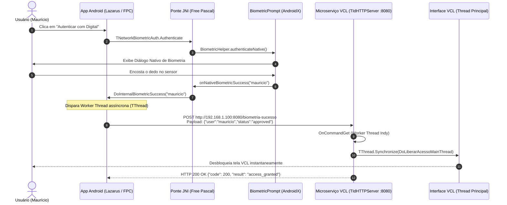

# Solução de Autenticação Biométrica em Rede Local (Android Mobile -> PC VCL)
**Conect Solutions TI** — Engenharia de Sistemas Distribuídos e Mobile Cross-Platform

Este projeto implementa uma solução corporativa de autenticação em dois fatores e liberação remota de acesso via biometria física (digital) em rede local, conectando um dispositivo Android (compilado via Lazarus/FPC com wrapper Java AndroidX) a um sistema desktop VCL/LCL rodando em ambiente Windows.

---

## 1. Arquitetura da Solução



---

## 2. Estrutura de Diretórios do Projeto

```text
c:\Projetos Antigrtavity\Biometria Lazarus\
├── android/
│   ├── build.gradle                              # Configuração raiz Gradle
│   └── app/
│       ├── build.gradle                          # Dependência 'androidx.biometric:biometric:1.1.0'
│       └── src/main/
│           ├── AndroidManifest.xml               # Permissões (USE_BIOMETRIC, INTERNET, CleartextTraffic)
│           └── java/com/conectsolutions/biometria/
│               └── BiometricHelper.java          # Wrapper Java com BiometricPrompt e hooks JNI
├── lazarus_android/
│   ├── UNetworkBiometricAuth.pas                 # Componente TComponent TNetworkBiometricAuth
│   └── UFormMainAndroid.pas                      # Exemplo de formulário de autenticação no celular
└── pc_vcl_server/
    ├── UWebServerVCL.pas                         # Servidor HTTP Indy com TThread.Synchronize
    ├── UWebServerVCL.dfm                         # Definição do Form para Delphi
    └── UWebServerVCL.lfm                         # Definição do Form para Lazarus LCL
```

---

## 3. Módulos Técnicos

### Módulo 1: O Wrapper Android (Java / Gradle)
* **Localização:** `android/app/src/main/java/com/conectsolutions/biometria/BiometricHelper.java`
* **Dependência Gradle:** `androidx.biometric:biometric:1.1.0`
* **Pontos Críticos:**
  * Execução forçada na Thread Principal (`activity.runOnUiThread`) para satisfazer as restrições da API `BiometricPrompt`.
  * Verificação antecipada de hardware com `BiometricManager.from(context).canAuthenticate(...)`.
  * Exportação de métodos nativos (`native void onNativeBiometricSuccess(...)` e `onNativeBiometricError(...)`) conectados diretamente ao Free Pascal.
  * Habilitação de `android:usesCleartextTraffic="true"` no `AndroidManifest.xml` para permitir chamadas HTTP diretas em rede local sem exigência de certificados SSL no PC de desenvolvimento.

### Módulo 2: O Componente Lazarus (`TNetworkBiometricAuth`)
* **Localização:** `lazarus_android/UNetworkBiometricAuth.pas`
* **Propriedades Principais:**
  * `PCServerIP`: Endereço IP do computador na rede local (ex: `'192.168.1.100'`).
  * `Port`: Porta TCP do serviço (padrão: `8080`).
  * `Route`: Rota de autenticação (padrão: `'/biometria-sucesso'`).
  * `UserName`: Usuário logado no dispositivo (padrão: `'mauricio'`).
  * `AutoSendOnSuccess`: Quando `True`, dispara o envio HTTP automaticamente após o sucesso da digital.
* **Segurança de Concorrência Mobile:** O envio do POST HTTP é executado dentro de uma subclasse de `TThread` (`TBiometricHttpWorkerThread`), prevenindo o travamento da interface e evitando a exceção fatal do Android `android.os.NetworkOnMainThreadException`.

### Módulo 3: O Servidor HTTP no Sistema VCL (PC)
* **Localização:** `pc_vcl_server/UWebServerVCL.pas`
* **Componente Base:** `TIdHTTPServer` (Indy 10)
* **Tratamento do Evento `OnCommandGet`:**
  * Escuta a porta `8080` e intercepta exclusivamente `/biometria-sucesso`.
  * Lê o stream do payload e extrai os campos JSON `user` e `status`.
  * Valida se `status = 'approved'`.
  * **Sincronização de Threads:** Por rodar dentro de uma thread de socket do Indy, qualquer manipulação direta de componentes visuais VCL causaria violações de acesso (*Access Violation*) ou congelamento (*Deadlock*). A sincronização com a Thread Principal é garantida via `TThread.Synchronize(nil, DoLiberarAcessoMainThread)`.

---

## 4. Teste Rápido de Integração (Sem o celular em mãos)

Para validar o servidor VCL no PC imediatamente antes de realizar o deploy no Android, execute no PowerShell:

```powershell
Invoke-RestMethod -Uri "http://localhost:8080/biometria-sucesso" `
  -Method POST `
  -Headers @{ "Content-Type" = "application/json; charset=utf-8" } `
  -Body '{"user": "mauricio", "status": "approved"}'
```

O servidor VCL responderá instantaneamente com:
```json
{
  "code": 200,
  "result": "access_granted",
  "user": "mauricio",
  "message": "Acesso liberado com sucesso no sistema VCL!"
}
```
E a interface gráfica mudará de **Vermelho** ("SISTEMA BLOQUEADO") para **Verde** ("ACESSO BIOMÉTRICO APROVADO E LIBERADO!").

