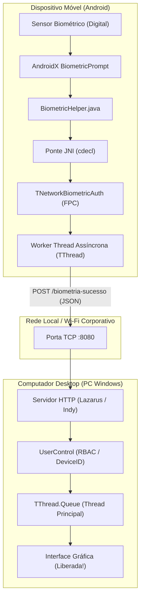
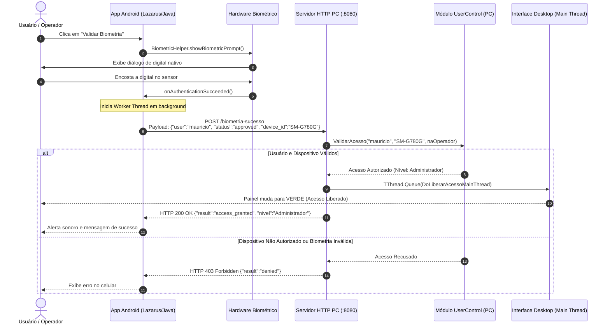

# Arquitetura da Solução de Autenticação Biométrica
**Conect Solutions TI** — Engenharia de Sistemas Distribuídos e Mobile Cross-Platform

---

## 1. Visão Geral

A solução permite que um operador ou usuário corporativo utilize o sensor de impressão digital de seu smartphone Android para liberar instantaneamente o acesso ou aprovar operações restritas em um sistema Desktop Windows (desenvolvido em **Lazarus LCL** ou **Delphi VCL**).

A comunicação ocorre estritamente dentro da rede local da empresa (via Wi-Fi ou túnel USB/ADB), eliminando a dependência de servidores de nuvem externos e garantindo latência de milissegundos e soberania total dos dados.



---

## 2. Diagrama de Sequência Detalhado



---

## 3. Topologia de Rede e Meios de Comunicação

A solução suporta dois canais de transporte de rede:

### 3.1. Rede Sem Fio (Wi-Fi Local)
* O celular Android e o PC Desktop conectam-se ao mesmo roteador ou switch corporativo na mesma sub-rede (ex: `192.168.15.x`).
* O app dispara as requisições diretamente para o IP local do computador:
  `http://192.168.15.119:8080/biometria-sucesso`.
* **Requisito:** A opção *AP Isolation* (Isolamento de Clientes) do ponto de acesso Wi-Fi deve estar desativada.

### 3.2. Cabo USB com Port Forwarding Reverso (Zero Wi-Fi / Alta Confiabilidade)
* Útil para terminais de caixa (PDV) onde o Wi-Fi não está disponível ou há restrições de segurança.
* O celular permanece conectado via cabo USB com Depuração USB ativada.
* O comando do ADB mapeia a porta:
  ```powershell
  adb reverse tcp:8080 tcp:8080
  ```
* O celular passa a se comunicar com o PC através de `http://127.0.0.1:8080/biometria-sucesso` com latência inferior a 5 milissegundos e imune a oscilações de sinal de rádio.

---

## 4. Segurança e Integridade

1. **Proteção contra travamento no Android (`NetworkOnMainThreadException`)**:
   Todas as requisições de rede no Android são executadas em threads secundárias dedicadas (`TThread` no Pascal ou `ExecutorService` no Java).
2. **Proteção contra corrupção visual no Windows (Thread Safety)**:
   Os componentes de interface da VCL e LCL não aceitam modificações de threads secundárias do socket. O envio de dados para a interface é enfileirado estritamente na Thread Principal via `TThread.Queue`.
3. **Tráfego HTTP sem SSL em Rede Local (`usesCleartextTraffic`)**:
   O `AndroidManifest.xml` foi configurado explicitamente para aceitar HTTP plano (`android:usesCleartextTraffic="true"`), dispensando a necessidade de instalar certificados SSL autoassinados em cada PC de desenvolvimento.

